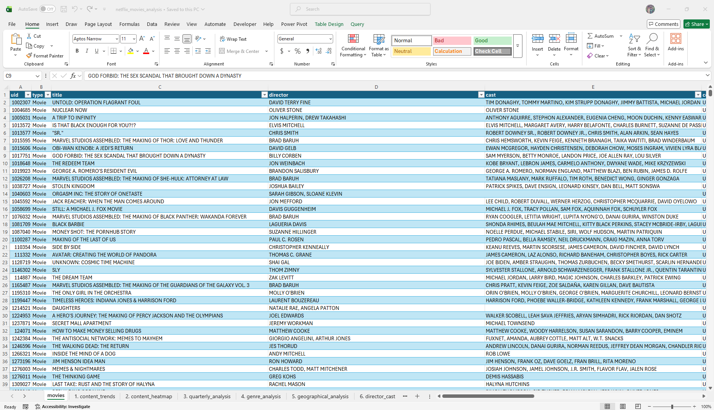
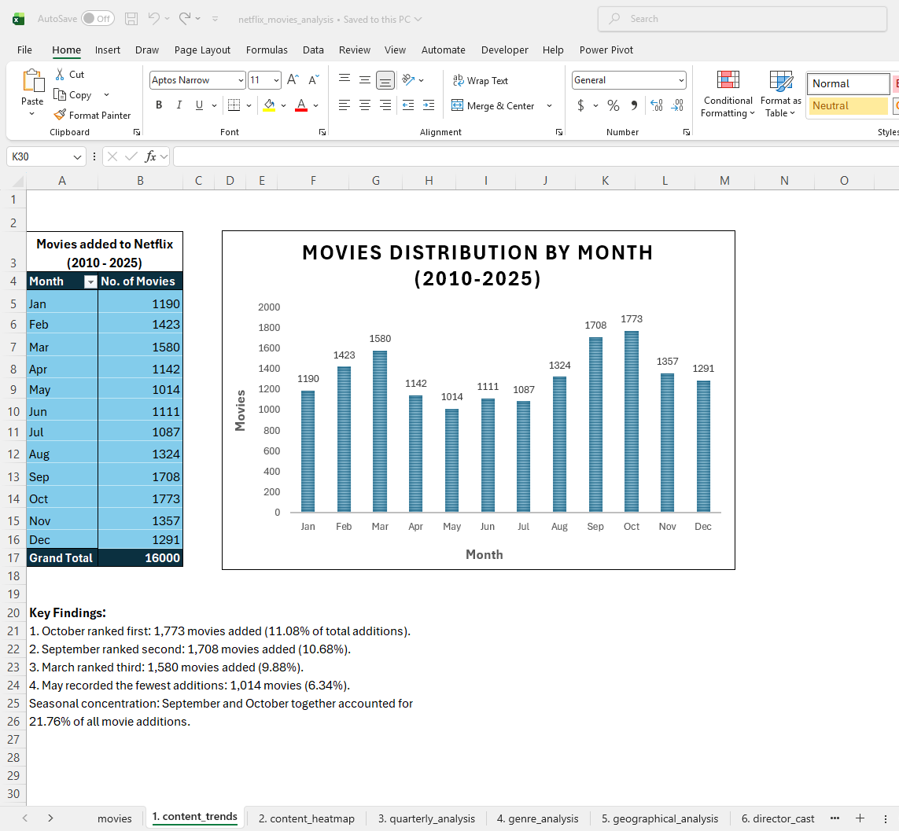

# Netflix Movies & TV Shows Data Analysis

An end-to-end data analysis project exploring Netflix Movies and TV Shows using Microsoft Excel and Power BI. This project focuses on data preparation, data modeling, exploratory analysis, visualization, and extracting meaningful insights from Netflix's content catalogue.

## Project Overview

This project analyzes two separate datasets containing Netflix Movies and TV Shows information. The analysis is divided into two components, with each tool being used to explore a different part of the dataset.

- **Microsoft Excel:** Analysis of Netflix Movies using Power Query, relational data modeling, PivotTables, and PivotCharts.
- **Microsoft Power BI:** Analysis of Netflix TV Shows using Power Query, data modeling, and interactive dashboards.

The objective is to demonstrate practical data analytics skills and the application of business intelligence tools to transform raw datasets into meaningful analytical insights.


## Project Walkthrough

Watch the complete project walkthrough on YouTube:

[](https://youtube.com/playlist?list=PLFcdFLd86vdw&si=2S1XLISm0hZgcbUB)

| Project Component | Tool | Video |
|---|---|---|
| Netflix Movies Analysis | Microsoft Excel | [Watch on YouTube](https://youtu.be/NVLI6psbFkw) |
| Netflix TV Shows Analysis | Microsoft Power BI | [Watch on YouTube](https://youtu.be/PZG-fSzb4ik) |


## Tools & Technologies

| Tool / Technology | Application |
|---|---|
| Microsoft Excel | Data analysis and visualization |
| Power Query | Data import, cleaning, and transformation |
| Excel Data Model | Relational data modeling |
| PivotTables | Exploratory and multidimensional analysis |
| PivotCharts | Data visualization |
| Microsoft Power BI | Interactive reporting and dashboard development |
| DAX | Measures and calculations in Power BI, where applicable |

## Dataset Information

The project uses two datasets containing Netflix Movies and TV Shows information.

| Dataset | Records | Description |
|---|---:|---|
| Netflix Movies | 16,000 | Movie titles and associated attributes |
| Netflix TV Shows | 16,000 | TV Show titles and associated attributes |

The datasets include information such as:

- Title and content type
- Release year
- Director and cast
- Country
- Genre
- Content rating
- Date added
- Duration and description

Both original CSV files are available in the `Dataset` directory.

## Project Structure

```text
Netflix-Movies-and-Series-Data-Analytics/
│
├── Dataset/
│   ├── netflix_movies_detailed_up_to_2025.csv
│   └── netflix_tv_shows_detailed_up_to_2025.csv
│
├── Excel/
│   └── netflix_movies_analysis.xlsx
│
├── Power BI/
│   └── netflix_tv_series_dashboard.pbix
│
├── screenshots/
│   ├── Excel/
│   └── Power BI/
│
├── .gitattributes
└── README.md
```

## 1. Netflix Movies Analysis — Microsoft Excel

The Excel component focuses on analyzing the Netflix Movies dataset using Power Query, the Excel Data Model, PivotTables, and PivotCharts.

### Analysis Performed

- Content addition trends by month and year.
- Monthly content addition heatmap.
- Quarterly content addition analysis.
- Movie distribution by genre.
- Geographical distribution of movies.
- Top directors by number of movie associations.
- Top cast members by number of movie associations.
- Most popular movies using popularity, vote count, and average vote metrics.


## Excel Analysis Screenshots

### 1. Dataset Overview


### 2. Monthly Content Distribution


### 3. Monthly Content Addition Heatmap


### 4. Quarterly Content Analysis


### 5. Genre Analysis


### 6. Geographical Analysis


### 7. Director Analysis


### 8. Cast Analysis


### 9. Most Popular Movies


## 2. Netflix TV Shows Analysis — Microsoft Power BI

The Power BI component focuses on analyzing Netflix TV Shows and presenting the results through an interactive, multi-page report.

### Analysis and Reporting

The Power BI workflow covers:

- Data import and transformation using Power Query.
- Data preparation and modeling.
- Exploratory analysis of Netflix TV Shows.
- Development of interactive visualizations.
- Multi-page dashboard design and navigation.
- Presentation of analytical findings through an interactive report.


## Power BI Dashboard Screenshots

### 1. Dashboard Screenshot – Page 1


### 2. Dashboard Screenshot – Page 2


### 3. Dashboard Screenshot – Additional View


Explore the complete walkthrough: [Netflix TV Shows Analysis using Microsoft Power BI](https://youtu.be/PZG-fSzb4ik).

## Key Findings

Some observations from the Excel Movies analysis include:

- October recorded the highest number of movie additions, with 1,773 records, followed by September with 1,708.
- The fourth quarter recorded the highest number of movie additions, with 4,421 records.
- Drama was the most represented genre, with 6,910 movie associations, followed by Comedy and Thriller.
- The United States led the geographical distribution with 7,762 movie-country associations.
- Tyler Perry appeared as the director with the highest number of movie associations among the top 15 directors analyzed.
- Min Do-yoon led the analyzed cast-member ranking with 111 movie associations.
- The Gorge ranked first in the popularity-based movie analysis, with 3,876 popularity points.

Note: Genre, country, director, and cast counts represent associations and may include multiple associations for a single movie.

## Project Scope

This project focuses on Microsoft Excel and Microsoft Power BI.

SQL and Python are not included in the scope of this project.

## Repository

Access the complete project files, datasets, Excel workbook, Power BI report, and screenshots:

[GitHub Repository — Netflix Movies & Series Data Analytics](https://github.com/thakurrrchandan/Netflix-Movies-and-Series-Data-Analytics)

## Disclaimer

This is an independent data analytics portfolio project developed for educational and demonstration purposes.

Netflix is a trademark of Netflix, Inc. This project is not affiliated with, endorsed by, or sponsored by Netflix.

The analysis is based on the datasets included in this repository. Findings should be interpreted within the limitations and structure of the available data.